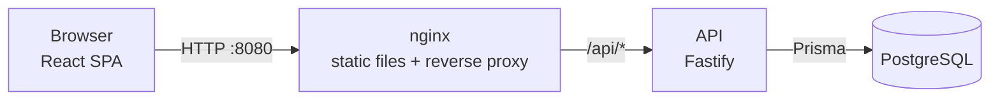

# User Management System

A back-office application to register users and manage existing ones.

- **API** — Node.js 22 + TypeScript, [Fastify 5](https://fastify.dev), [Prisma 7](https://www.prisma.io) and PostgreSQL 17. REST endpoints for the **User** and **Session** domains, documented with OpenAPI.
- **Web** — React 19 + TypeScript, [MUI 7](https://mui.com), React Router 7, TanStack Query and React Hook Form. Sign-up / sign-in, a user management dashboard and a persistent light/dark theme.
- **Quality** — 180+ automated tests (unit, HTTP, integration, component and Playwright end-to-end), CI pipeline, fully containerised with Docker Compose.

| Assignment part                    | Where                                                                                                                                        |
| ---------------------------------- | -------------------------------------------------------------------------------------------------------------------------------------------- |
| Part 0 – Backend                   | [`apps/api`](apps/api)                                                                                                                       |
| Part 1 – Sign-up / sign-in         | [`apps/web/src/pages`](apps/web/src/pages), [`apps/web/src/auth`](apps/web/src/auth)                                                         |
| Part 2 – User management dashboard | [`apps/web/src/pages/DashboardPage.tsx`](apps/web/src/pages/DashboardPage.tsx), [`apps/web/src/features/users`](apps/web/src/features/users) |
| Part 3 – Themes                    | [`apps/web/src/theme`](apps/web/src/theme), [`apps/web/public/theme-init.js`](apps/web/public/theme-init.js)                                 |
| Part 4 – Testing                   | `apps/*/test`, [`packages/shared/test`](packages/shared/test), [`e2e`](e2e)                                                                  |

---

## Contents

- [Quick start (Docker)](#quick-start-docker)
- [Local development](#local-development)
- [Testing](#testing)
- [Architecture](#architecture)
- [API reference](#api-reference)
- [Domain rules, decisions and assumptions](#domain-rules-decisions-and-assumptions)
- [Security and production readiness](#security-and-production-readiness)
- [Future improvements and known limitations](#future-improvements-and-known-limitations)

---

## Quick start (Docker)

Requirements: Docker with Compose v2.

```bash
docker compose up -d --build --wait
```

Then open **http://localhost:8080**.

| What                 | Where                                                                               |
| -------------------- | ----------------------------------------------------------------------------------- |
| Web application      | http://localhost:8080                                                               |
| API (through nginx)  | http://localhost:8080/api                                                           |
| Swagger UI / OpenAPI | http://localhost:8080/api/docs (JSON at `/api/docs/json`)                           |
| Demo admin account   | `admin@example.com` / `Admin123!` (plus 14 demo users with password `Password123!`) |

The stack consists of three services: `db` (PostgreSQL), `api` (applies migrations and the idempotent demo seed on start-up) and `web` (nginx serving the SPA and proxying `/api`). They start in order using health checks.

Everything is configurable through environment variables or a root `.env` file — see [`.env.example`](.env.example). For example, if ports 8080/5432 are taken:

```bash
WEB_PORT=8081 POSTGRES_PORT=5433 docker compose up -d --build --wait
```

Set `SEED_DEMO_DATA=false` to start with an empty database (then simply sign up). Stop everything with `docker compose down` (add `-v` to also delete the database volume).

---

## Local development

Requirements: **Node.js 22+** (see `.nvmrc`), npm 10+, Docker (for PostgreSQL).

```bash
npm ci                                           # install all workspaces
cp apps/api/.env.example apps/api/.env           # API configuration
docker compose up -d db                          # PostgreSQL only
npm run db:deploy -w @ums/api                    # apply migrations
npm run db:seed -w @ums/api                      # optional demo data
npm run dev                                      # API on :3000 + web on :5173
```

Open http://localhost:5173. The Vite dev server proxies `/api` to the API (`API_PROXY_TARGET`, default `http://localhost:3000`), so the browser always talks to a single origin, exactly like nginx does in Docker.

> If you change `PORT` in `apps/api/.env`, start the web app with the matching proxy target, e.g. `API_PROXY_TARGET=http://localhost:4000 npm run dev -w @ums/web`. If you change `POSTGRES_PORT`, update `DATABASE_URL` accordingly.

### Useful scripts

| Command                                     | Description                                                 |
| ------------------------------------------- | ----------------------------------------------------------- |
| `npm run dev`                               | API (tsx watch) and web (Vite) in parallel                  |
| `npm run build`                             | Production builds of the API (tsup) and the web app (Vite)  |
| `npm run lint` / `npm run format`           | ESLint / Prettier                                           |
| `npm run typecheck`                         | `tsc --noEmit` in every workspace                           |
| `npm test` / `npm run test:coverage`        | Unit, HTTP and component tests (with coverage thresholds)   |
| `npm run test:integration`                  | API integration tests against PostgreSQL                    |
| `npm run e2e:docker`                        | Build + start the Docker stack and run the Playwright suite |
| `npm run e2e`                               | Playwright suite against an already running stack           |
| `npm run db:migrate -w @ums/api`            | Create/apply a new migration in development                 |
| `npm run docker:up` / `npm run docker:down` | Start/stop the full stack                                   |

> **Note on npm versions:** the lockfile installs fine with npm 10 (`npm ci`). When _adding_ dependencies, npm 10's resolver crashes on Vitest's optional peer graph (`Cannot read properties of null (reading 'edgesOut')`); use `npx npm@11 install <pkg>` for that.

---

## Testing

| Layer           | Tooling                                    | Location                    | What it covers                                                                                                              |
| --------------- | ------------------------------------------ | --------------------------- | --------------------------------------------------------------------------------------------------------------------------- |
| Shared schemas  | Vitest                                     | `packages/shared/test`      | Validation contracts (password confirmation, strict PATCH, pagination)                                                      |
| API unit        | Vitest, in-memory repositories, fake clock | `apps/api/test/unit`        | Every domain rule in `UserService` / `SessionService`, password hashing, env validation                                     |
| API HTTP        | Vitest + `app.inject`                      | `apps/api/test/http`        | Real Fastify app: status/error codes, validation, auth guard, pagination, rate limiting, CORS, OpenAPI, no password leakage |
| API integration | Vitest + PostgreSQL                        | `apps/api/test/integration` | Prisma adapters and a full API flow on a real database, incl. an atomic logins-counter concurrency test                     |
| Web component   | Vitest, Testing Library, MSW               | `apps/web/test`             | The whole app rendered against an in-memory fake API: auth flows, guards, dashboard CRUD and pagination, theme persistence  |
| End-to-end      | Playwright                                 | `e2e/tests`                 | Real stack (nginx + API + DB) in Chromium, auth flow also on a phone viewport                                               |

```bash
npm test                    # shared + API (unit/HTTP) + web
npm run test:coverage       # same, with coverage reports and thresholds
npm run test:integration    # needs PostgreSQL (docker compose up -d db); uses a separate `<db>_test` database
npm run e2e:docker          # starts the Docker stack, then runs Playwright (first time: npx playwright install chromium)
```

Current results: **16** shared, **91** API unit/HTTP, **14** API integration, **41** web component and **25** end-to-end tests (17 desktop + 8 mobile). Line coverage: shared 100 %, API ≈ 99 %, web ≈ 97 % (thresholds are enforced in each `vitest` config; the Prisma adapters and process wiring are covered by the integration suite instead).

The integration suite never touches the development database: it uses `TEST_DATABASE_URL` or `DATABASE_URL` with a `_test` suffix, creates it if needed and applies migrations in a global setup.

---

## Architecture



### Repository layout (npm workspaces)

```
apps/
  api/                 Fastify REST API
    prisma/            schema, migrations, seed
    src/
      config/          zod-validated environment
      common/          errors, clock, password hasher
      infrastructure/  Prisma client factory
      plugins/         auth guard, error handler, security, swagger
      modules/
        users/         routes · service · repository port · Prisma adapter · mapper
        sessions/      routes · service · repository port · Prisma adapter · mapper
        health/
      app.ts           application factory (dependencies injected)
      container.ts     composition root (wires concrete implementations)
      server.ts        process entry point, graceful shutdown
    test/              unit · http · integration · test doubles
  web/                 React SPA
    src/
      api/             fetch wrapper + typed endpoint modules
      auth/            AuthProvider, session storage, route guards
      features/users/  table, dialogs, query hooks
      pages/ layouts/ components/ theme/
    test/              component tests + MSW fake API
packages/shared/       zod schemas & DTO types shared by API and web
e2e/                   Playwright tests
```

### Backend

- **Layered / ports & adapters.** Routes (HTTP concerns, validation) → services (use-cases and domain rules) → repository interfaces (ports) → Prisma adapters. Services depend only on interfaces, so they are unit-tested against in-memory implementations with a controllable clock.
- **Dependency injection without a framework.** `buildApp(deps)` receives its collaborators; `container.ts` is the single composition root. The same app factory runs in production and in HTTP tests.
- **One source of truth for contracts.** `@ums/shared` holds zod schemas used for API validation, OpenAPI generation, response serialisation and client-side form validation.
- **Consistent errors.** Every failure has the shape `{ "error": { "code", "message", "details?" } }`; the client relies on `code`, never on messages.
- **Data access.** Explicit `select` projections (the password hash is only read by authentication), a single round-trip `$transaction([findMany, count])` for pagination backed by a `(created_at DESC, id DESC)` index, and atomic conditional updates for the domain rules (see below).

### Frontend

- **Server state** with TanStack Query (caching, invalidation after mutations, previous page kept while the next loads); **forms** with React Hook Form + the shared zod schemas; **routing** with React Router data routers and route-level code splitting.
- **AuthProvider** owns the session lifecycle; **RequireAuth** / **RedirectIfAuthenticated** guards implement the navigation rules.
- **Theming** with MUI CSS-variable color schemes; the selected mode is persisted and applied before the bundle loads.

---

## API reference

All routes are prefixed with `/api`. Authenticated routes expect `Authorization: Bearer <sessionId>`. Interactive documentation: `/api/docs`.

| Method   | Path                       | Auth | Description                                                                                              |
| -------- | -------------------------- | ---- | -------------------------------------------------------------------------------------------------------- |
| `POST`   | `/auth/sign-up`            | –    | Create an (active) user and their first session → `201` session with user                                |
| `POST`   | `/sessions`                | –    | Sign in: create a new session → `201` session with user                                                  |
| `GET`    | `/sessions/current`        | ✓    | The session identified by the bearer token, with its user                                                |
| `DELETE` | `/sessions/:id`            | ✓    | Terminate one of your sessions (sign out) → `204`                                                        |
| `GET`    | `/users?page=&pageSize=`   | ✓    | Users, newest first. `pageSize` defaults to 6 (max 100) → `{ items, page, pageSize, total, totalPages }` |
| `GET`    | `/users/:id`               | ✓    | One user                                                                                                 |
| `POST`   | `/users`                   | ✓    | Create a user (`firstName`, `lastName`, `email`, `password`, `status?`) → `201`                          |
| `PATCH`  | `/users/:id`               | ✓    | Update `firstName`, `lastName`, `email` and/or `status`                                                  |
| `DELETE` | `/users/:id`               | ✓    | Delete a user and their sessions → `204`                                                                 |
| `GET`    | `/health`, `/health/ready` | –    | Liveness / readiness (database ping)                                                                     |

Example:

```bash
curl -s -X POST http://localhost:8080/api/sessions \
  -H 'content-type: application/json' \
  -d '{"email":"admin@example.com","password":"Admin123!"}'
# {"id":"<sessionId>","userId":"…","createdAt":"…","terminatedAt":null,"user":{…}}

curl -s http://localhost:8080/api/users?page=1 -H 'authorization: Bearer <sessionId>'
```

**Error codes:** `VALIDATION_ERROR` (400), `BAD_REQUEST` (400), `UNAUTHORIZED` / `SESSION_INVALID` / `INVALID_CREDENTIALS` (401), `USER_INACTIVE` (403), `USER_NOT_FOUND` / `SESSION_NOT_FOUND` / `ROUTE_NOT_FOUND` (404), `EMAIL_TAKEN` / `CANNOT_MODIFY_SELF` (409), `USER_INACTIVE_NAME_LOCKED` (422), `RATE_LIMITED` (429), `INTERNAL_ERROR` (500).

---

## Domain rules, decisions and assumptions

**Domains.** `User`: id, first name, last name, status (`active` / `inactive`), logins counter, creation time, last update time — plus **`email` and `passwordHash`**, which are not in the brief but are required to sign in (e-mail is the login identifier, unique and stored lower-cased). `Session`: id, user id, creation time, termination time.

**Rules from the brief and how they are enforced**

| Rule                                                      | Implementation                                                                                                                                                                                                                                                                                                                      |
| --------------------------------------------------------- | ----------------------------------------------------------------------------------------------------------------------------------------------------------------------------------------------------------------------------------------------------------------------------------------------------------------------------------- |
| Creation time cannot be updated                           | `PATCH /users/:id` uses a strict schema: `createdAt` (and `id`, `updatedAt`, `loginsCount`) are rejected with `400`. The repository never writes `createdAt` on update.                                                                                                                                                             |
| Last update time must always be updated                   | Every update sets `updatedAt` explicitly (and Prisma's `@updatedAt` as a safety net). A sign-in also updates the user (logins counter), so it refreshes `updatedAt` too.                                                                                                                                                            |
| First/last name cannot be updated if the user is inactive | Checked against the **persisted** status: renaming an inactive user returns `422` even if the same request re-activates them (activate first, then rename). Re-sending unchanged names is allowed, so full-form submits work. The UPDATE has an extra `status = 'active'` filter, so the rule also holds under concurrent requests. |
| Inactive users cannot create sessions                     | Sign-in returns `403 USER_INACTIVE` (only after the password was verified, so status isn't disclosed to strangers). The session INSERT is nested in an `UPDATE … WHERE status = 'active'`, making it race-free.                                                                                                                     |

**Other decisions**

- **Session id = bearer token.** As requested, the `id` returned by sign-in / sign-up is used as the session identifier on every request (`Authorization: Bearer <id>`). Ids are random UUIDv4 generated with a CSPRNG. Sessions expire `SESSION_TTL_HOURS` (default 24 h) after creation; expired sessions are terminated lazily.
- **Logins counter** is incremented atomically on every session creation, including the one created by sign-up.
- **Deactivating a user terminates their active sessions** in the same transaction, and sessions of inactive users are rejected anyway.
- **Every signed-in user is an administrator** (as stated in Part 2). To avoid locking yourself out, admins cannot delete or deactivate their own account (`409`).
- **Deleting a user** is a hard delete; their sessions are removed by `ON DELETE CASCADE`.
- **Admin-created users** get a password from the admin so they can sign in. Changing passwords and avatars is out of scope (avatars were explicitly not required).
- **Navigation:** visitors without a session see the sign-up page; after logging out (or when a session expires) users land on the sign-in page with a short explanation; users with a session are always forwarded to the dashboard.
- **Theme:** Light, Dark or System (default). The choice is stored in `localStorage` (`ums-theme-mode`).

---

## Security and production readiness

- Passwords hashed with **scrypt** (`node:crypto`, random salt, self-describing format so parameters can be raised later); constant-time comparison; a dummy hash is checked for unknown e-mails to avoid user enumeration via timing.
- **Rate limiting** per IP (global, plus a stricter limit on sign-in / sign-up against brute force); `trustProxy` enabled only behind nginx.
- **Security headers:** helmet on the API; nginx adds a strict Content-Security-Policy (no inline scripts — the theme bootstrap script is an external file), `X-Frame-Options`, `nosniff`, `Referrer-Policy`, `Permissions-Policy`.
- **Same-origin deployment** (nginx proxies `/api`), so no CORS in production; CORS can be enabled for specific origins via `CORS_ORIGIN`.
- **Fail-fast configuration** validated with zod; **structured logging** (pino) with request ids (`x-request-id`) and redaction of `Authorization` / `Cookie`; internal errors are logged but never leaked.
- **Health checks** (liveness / readiness with DB ping) wired into Docker health checks; **graceful shutdown** on `SIGTERM` / `SIGINT`.
- **Containers:** multi-stage builds, production-only dependencies, non-root users (`node`, nginx-unprivileged), migrations applied on start-up, no source maps shipped, long-term caching of fingerprinted assets.
- **CI:** formatting, lint, type-checks, tests with coverage thresholds, integration tests on PostgreSQL and the Playwright suite against the Docker stack.

---

## Future improvements and known limitations

- **Session storage in the browser.** The session id lives in `localStorage` because the brief asks the client to send it explicitly. An `HttpOnly`, `Secure`, `SameSite` cookie would protect it from XSS (with CSRF protection added).
- **Session ids are stored in clear text** in the database. Storing a hash of the token (and returning the raw value only once) would limit the impact of a database leak. A scheduled job should also purge old terminated/expired sessions; sliding expiration / "remember me" could be added.
- **Authorization model.** Every signed-in user is an admin, as specified. A real back-office needs roles/permissions (RBAC), an audit log of who changed what, and probably soft deletes.
- **Account lifecycle:** e-mail verification, password reset/change, password strength checks (e.g. breached-password lists), account lockout after repeated failures.
- **Concurrency:** updates are last-write-wins apart from the guarded rules; optimistic locking (`version` / `If-Match`) would prevent silently overwriting another admin's edit.
- **Dashboard features:** search, filters and sorting, bulk actions; cursor-based pagination for very large tables (offset pagination is fine at back-office scale).
- **Rate limiting is in-memory** (per API instance); with several replicas it should use a shared store such as Redis.
- **Observability:** metrics (Prometheus), tracing (OpenTelemetry) and error reporting (e.g. Sentry with the hidden source maps).
- **Bundle size:** MUI and zod dominate the initial JavaScript; `zod/mini` on the client or lighter components could reduce it further.
- **i18n / accessibility audit:** texts are English only; an automated axe check could be added to the e2e suite.
- **E2E in a container:** the Playwright suite runs on the host (or the CI runner); a dedicated Playwright image/profile would remove the local browser installation step.

---

## Commit history

The project was built in small, self-contained commits (Conventional Commits), each with a description of what changed and why — from the monorepo skeleton, through the API, its tests, the web app (Part 1 → Part 2 → Part 3), component tests, containerisation, end-to-end tests and CI. Use `git log` to follow the progression.
